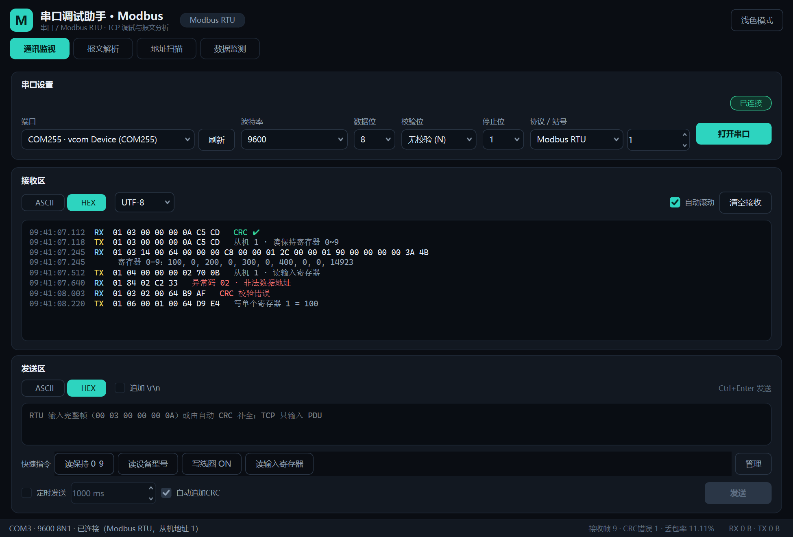
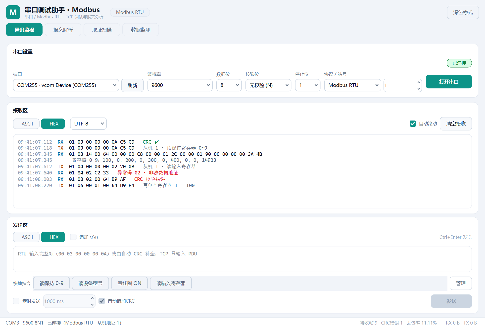

# 串口调试助手 · Modbus（RTU / TCP）

一个基于 **PyQt6** 的单文件串口调试桌面工具，支持 Modbus RTU 与 Modbus TCP 双协议，面向工业现场调试、数据中心动环监控、PLC / 仪表联调等场景。纯本机运行，不联网、不上传任何数据。



## 功能特性

- **串口通信**：独立工作线程收发，界面不卡顿；串口热插拔自动检测；接收区带毫秒时间戳、收发分色、CRC 错误红色标记
- **Modbus 双协议**：RTU（CRC16 校验）/ TCP（MBAP 头），四个页面实时同步
- **通讯监视**：ASCII / HEX 收发、定时发送、自动追加 CRC、快捷指令管理、自动滚动
- **报文解析**：协议 / 报文类型 / 数据类型可选，一键解析帧结构；内置 CRC16 计算工具与 ASCII / HEX 互转
- **地址扫描**：1~247 从机批量扫描，显示每台从机响应时间
- **数据监测**：多从机寄存器轮询、数值格式切换、Excel 点表导入导出
- **界面**：深 / 浅双主题一键切换，青色工业风，圆角卡片布局，单文件绿色启动



## 直接下载使用（免安装）

1. 打开本仓库页面右侧的 **Releases** 入口（或直接访问 Releases 页面）；
2. 进入最新版本 **v1.0.0**；
3. 在 **Assets（附件）** 中下载 `串口调试助手_Modbus.exe`（约 34MB）；
4. 下载后双击即可运行，**无需安装 Python、无需解压**（Windows 10 / 11 64 位）。

> 首次启动会有几秒自解压时间，属正常现象；程序未做数字签名，若被 SmartScreen 拦截，选择「更多信息 → 仍要运行」即可。

## 源码运行

```bash
pip install -r requirements.txt
python serial_debug_modbus.py
```

依赖：Python 3.9+、PyQt6、pyserial；Excel 点表导入导出需要 openpyxl（可选）。

## 使用方法

1. **连接串口**：在「串口通信」页选择 COM 口、波特率（常用 9600）、数据位 / 停止位 / 校验位，点击「打开串口」；
2. **收发数据**：发送区输入十六进制或 ASCII，可勾选 HEX 发送 / HEX 显示，支持定时发送与自动追加 CRC；
3. **Modbus RTU**：切换到 Modbus 页，配置从机地址、功能码（03 / 06 / 16 等）、寄存器地址与数量，一键读 / 写；
4. **Modbus TCP**：填写设备 IP 与端口（默认 502），协议切换为 TCP 后同样读写；
5. **扫描从机**：批量扫描 1~247 地址，快速找出在线从机；
6. **轮询监测**：配置寄存器轮询列表，持续采集并刷新实时数值，支持导出 Excel 点表；
7. **报文解析 / 工具**：在报文解析页粘贴原始报文一键拆解；CRC16 计算器、ASCII / HEX 互转在工具区。

配置（串口参数、主题、快捷指令）保存在程序旁的 `config.json`，删除即恢复默认。

## 打包为 exe（可选）

```bash
pyinstaller --onefile --windowed --name "串口调试助手_Modbus" \
  --icon icon.ico --add-data "icon.ico;." serial_debug_modbus.py
```

## 目录结构

```
modbus-serial-tool/
├── serial_debug_modbus.py   # 主程序（单文件）
├── icon.ico                 # 应用图标
├── requirements.txt
├── README.md
├── screenshot-dark.png
└── screenshot-light.png
```

## 说明

- 程序不进行任何网络请求，仅操作本机串口；
- 仅供学习与现场调试使用，现场接线与通信参数请以设备手册为准。
